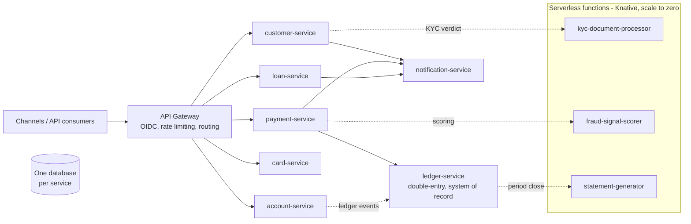

# Open Banking — Reference Core Banking Platform

A **standard, generic core banking platform** that any institution can deploy and adapt:
built as **microservices and serverless functions** on **Java 21 + Quarkus**, aligned with
**The Twelve-Factor App** methodology for cloud computing, and documented under the
architecture and quality standards listed below.

> This is a *reference implementation*: a small, complete, runnable core — not a demo toy.
> Every rule that matters in banking (double-entry ledger, idempotent payments, masked PANs,
> minor-unit money) is enforced in code and covered by tests.

## Standards alignment

| Standard | What it governs here | Where |
|---|---|---|
| ISO/IEC/IEEE **42010** | Architecture description: stakeholders, concerns, viewpoints, views, decisions | [`docs/architecture/architecture-description.md`](docs/architecture/architecture-description.md) |
| ISO/IEC **25010** (SQuaRE) | Product quality model and quality-attribute scenarios | [`docs/architecture/quality-attributes.md`](docs/architecture/quality-attributes.md) |
| ISO/IEC/IEEE **15288 & 12207** | System and software life-cycle processes | [`docs/lifecycle/software-lifecycle.md`](docs/lifecycle/software-lifecycle.md) |
| ISO/IEC **27001 & 27002** | Information security management and controls | [`docs/security/`](docs/security/) |
| **The Twelve-Factor App** | Cloud-native application methodology | [`docs/architecture/twelve-factor.md`](docs/architecture/twelve-factor.md) |
| OpenAPI 3 / AsyncAPI 2 (CloudEvents) | API and event contracts | [`contracts/`](contracts/) |
| ISO 4217 / ISO 20022 (alignment) | Currency codes; payment message semantics | [`docs/data/data-architecture.md`](docs/data/data-architecture.md) |

Full traceability matrix: [`docs/compliance/standards-traceability.md`](docs/compliance/standards-traceability.md).

## The platform at a glance



### Microservices (Quarkus, `services/`)

| Service | Port | Bounded context | Responsibility |
|---|---|---|---|
| `customer-service` | 8081 | Party / Customer | Onboarding, identity data, KYC status |
| `account-service` | 8082 | Deposit Accounts | Current/savings accounts, balance read model |
| `ledger-service` | 8083 | General Ledger | **Double-entry journal — system of record for money** |
| `payment-service` | 8084 | Payments | Rail-agnostic payment orders, idempotent lifecycle |
| `card-service` | 8085 | Cards | Issuance and lifecycle — masked PAN only (PCI-minimized) |
| `loan-service` | 8086 | Lending | Origination, decisions, amortization schedules |
| `notification-service` | 8087 | Notifications | Channel-agnostic dispatch from domain events |

### Serverless functions (Quarkus Funqy + Knative, `functions/`)

| Function | Trigger | Responsibility |
|---|---|---|
| `kyc-document-processor` | HTTP / CloudEvent | Evaluates KYC document completeness → verdict |
| `fraud-signal-scorer` | HTTP / CloudEvent | Scores payment events: APPROVE / REVIEW / BLOCK + rationale |
| `statement-generator` | HTTP / CloudEvent | Builds account statement totals per period and currency |

## Design principles

1. **API-first** — contracts in `contracts/` are the source of truth; OpenAPI is generated from code and checked in CI.
2. **Database per service** — no shared databases, no cross-service joins; consistency via events and sagas.
3. **The ledger is the heart** — append-only, double-entry, balanced or rejected; corrections are compensating entries.
4. **Money is never a float** — integer minor units + ISO 4217 currency, everywhere.
5. **Hexagonal architecture** — domain logic depends on ports; infrastructure (persistence, rails, providers) is adapters.
6. **Config from the environment** — no secrets in code or config files (12-Factor III).
7. **Adapt by configuration, not by fork** — rails, providers, limits and templates are configuration (see *Adaptation guide*).

## Quick start

Prerequisites: Java 21, Maven 3.9+, and (optionally) Docker/Podman and Knative/OpenShift for deployment.

```bash
# Build and test everything
mvn verify

# Run one service in dev mode (live reload, Dev UI at /q/dev-ui)
mvn -pl services/ledger-service quarkus:dev

# Book a balanced journal entry
curl -X POST localhost:8083/api/v1/ledger/journal-entries -H 'Content-Type: application/json' -d '{
  "reference": "demo-1", "description": "Opening balances",
  "postings": [
    {"accountId": "11111111-1111-1111-1111-111111111111", "direction": "DEBIT",  "amountMinor": 10000, "currency": "USD"},
    {"accountId": "22222222-2222-2222-2222-222222222222", "direction": "CREDIT", "amountMinor": 10000, "currency": "USD"}
  ]}'

# Or start the local platform dependencies (PostgreSQL, Kafka, Keycloak)
docker compose up -d
```

## Deployment

- **Kubernetes / OpenShift**: Kustomize manifests in [`deploy/kubernetes/`](deploy/kubernetes/) (one Deployment + Service + HPA per service, probes, resource limits, env-based config).
- **Serverless**: Knative Services in [`deploy/knative/`](deploy/knative/) (scale to zero, CloudEvent triggers).
- **Local**: `docker-compose.yml` for dependencies; services run with `quarkus:dev`.

## Adaptation guide (deploy it as *your* core)

| You want to… | Change only… |
|---|---|
| Use your currency set / country | Configuration: ISO 4217 codes are data, not code |
| Settle through SEPA / FedNow / SPEI / a local rail | Select the rail adapter in `payment-service` configuration |
| Replace the in-memory persistence adapter | Implement the repository port with JPA on the service's own database (`DB_KIND`, `DB_URL`) |
| Plug your IdP | OIDC issuer URL at the API Gateway (`OIDC_ISSUER`) — no code change |
| Add a product (e.g. term deposits) | Add a bounded context following `docs/architecture/` and the service template |
| Rebrand notifications | Templates in `notification-service` configuration |

## Documentation map

- Architecture (42010): [`docs/architecture/architecture-description.md`](docs/architecture/architecture-description.md) · [diagrams](docs/architecture/diagrams.md) · [domain model](docs/architecture/domain-model.md) · [ADRs](docs/adr/)
- Quality (25010): [`docs/architecture/quality-attributes.md`](docs/architecture/quality-attributes.md)
- Twelve-Factor: [`docs/architecture/twelve-factor.md`](docs/architecture/twelve-factor.md)
- API standards: [`docs/api/api-standards.md`](docs/api/api-standards.md)
- Data: [`docs/data/data-architecture.md`](docs/data/data-architecture.md)
- Security (27001/27002): [`docs/security/security-architecture.md`](docs/security/security-architecture.md) · [control mapping](docs/security/iso-27001-27002-control-mapping.md) · [threat model](docs/security/threat-model.md)
- Life cycle (15288/12207): [`docs/lifecycle/software-lifecycle.md`](docs/lifecycle/software-lifecycle.md)
- Operations: [`docs/operations/runbook.md`](docs/operations/runbook.md) · [SLOs](docs/operations/slos.md)

## License

Apache-2.0 — see `LICENSE`.
