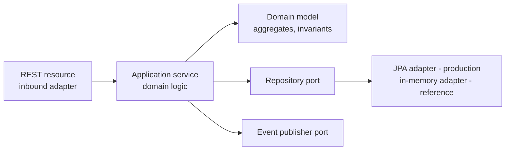

# Architecture Description — Open Banking Reference Core Banking Platform

**Conformance**: this document is the Architecture Description (AD) of the platform,
structured according to **ISO/IEC/IEEE 42010** (*Systems and software engineering —
Architecture description*). It identifies the system, its stakeholders and their concerns,
the architecture viewpoints that frame those concerns, the architecture views governed by
those viewpoints, the architecture decisions and their rationale, and the correspondences
that keep the views consistent.

| Field | Value |
|---|---|
| System of interest | Open Banking — Reference Core Banking Platform (`Open-Industries/open-banking`) |
| Version of this AD | 1.0 |
| Status | Baseline |
| Architecture framework | ISO/IEC/IEEE 42010; views documented with C4 model conventions and Mermaid diagrams |
| Implementation stack | Java 21, Quarkus 3, Maven multi-module; Kubernetes/OpenShift; Knative (OpenShift Serverless) |

---

## 1. System overview and purpose

The system is a **generic core banking platform**: the minimal complete set of capabilities
every retail bank needs — customers, deposit accounts, a double-entry general ledger,
payments, cards, loans and notifications — designed so an institution can **deploy it as-is
for a reference environment and adapt it by configuration** (rails, providers, currencies,
limits, templates) instead of forking the code.

Architectural style: **microservices** (one deployable per bounded context) complemented by
**serverless functions** for event-driven, bursty or periodic work, all aligned with
**The Twelve-Factor App** (see `twelve-factor.md`).

## 2. Stakeholders and concerns (42010 §5.3)

| Stakeholder | Role | Key concerns |
|---|---|---|
| Adopting bank / fintech | Owns and operates the platform | Adaptability, time-to-market, total cost, regulatory defensibility |
| Product owner | Defines banking products | Functional suitability, product configurability (ISO 25010) |
| Solution / enterprise architect | Governs evolution | Standards conformance, bounded-context integrity, decision traceability |
| Development teams | Build and change services | Modifiability, testability, clear contracts, independent deployability |
| Platform / SRE team | Runs Kubernetes/OpenShift | Reliability, observability, scalability, safe rollouts and rollbacks |
| CISO / security officer | Owns the ISMS (ISO 27001) | Confidentiality, integrity, least privilege, auditability, PCI DSS scope reduction |
| Compliance / risk officer | Regulatory reporting | Traceability, data retention, KYC/AML hooks, segregation of duties |
| External auditors | Independent assurance | Evidence: decisions (ADRs), control mapping, logs, life-cycle records |
| API consumers (channels, partners) | Integrate over OpenAPI/AsyncAPI | Contract stability, versioning, predictable errors, idempotency |
| End customers of the bank | Indirect users | Correct balances, payment finality, privacy of their data |

## 3. Architecture viewpoints (42010 §5.4)

Each viewpoint frames a set of concerns, establishes modeling conventions, and governs one view in §4.

| Viewpoint | Frames concerns of | Model kinds / conventions |
|---|---|---|
| **VP-1 Context** | Adopting institution, auditors | C4 System Context diagram; actors and external systems |
| **VP-2 Container (runtime structure)** | Architects, developers, SRE | C4 Container diagram; one container = one deployable unit; sync REST vs async CloudEvents distinguished |
| **VP-3 Component (service internals)** | Developers | Hexagonal (ports & adapters) component diagram per service |
| **VP-4 Domain** | Product owner, architects, compliance | Bounded-context map, aggregates, ubiquitous language (`domain-model.md`) |
| **VP-5 Data** | Architects, compliance, SRE | Database-per-service ownership matrix, ledger invariants (`../data/data-architecture.md`) |
| **VP-6 Deployment** | SRE, CISO | Kubernetes/Knative topology, environments, network zones |
| **VP-7 Security** | CISO, auditors | Trust boundaries, OIDC flows, control mapping to ISO/IEC 27002 (`../security/`) |
| **VP-8 Quality & operations** | SRE, product owner | ISO/IEC 25010 quality model, scenarios and SLOs (`quality-attributes.md`, `../operations/slos.md`) |

## 4. Architecture views

### 4.1 Context view (VP-1)

See `diagrams.md` — Diagram D-1. The platform sits between digital channels and external
financial infrastructure: identity provider, payment rails (SEPA/FedNow/SPEI/generic),
card networks via a tokenization vault, notification providers (email/SMS/push), and the
institution's reporting/regulatory systems fed from ledger events.

### 4.2 Container view (VP-2)

See `diagrams.md` — Diagram D-2 (also in the repository README). Containers:

- **API Gateway** (platform-provided): TLS termination, OIDC validation, rate limiting, routing.
- **7 Quarkus microservices** (`services/`), each independently deployable, each owning its data.
- **3 Quarkus Funqy functions** (`functions/`) on Knative: scale-to-zero, event-triggered.
- **Event backbone**: CloudEvents over the Knative Broker (Kafka-backed in production).
- **One database per service** (PostgreSQL in the reference deployment).

Synchronous calls are used only where an immediate answer is a business requirement
(e.g. payment creation, ledger booking). Everything else is event-driven.

### 4.3 Component view (VP-3) — hexagonal structure of every service

Rules: the domain depends on nothing external; adapters are replaceable without touching
domain code; every service in this repository follows the identical layout, which is itself
an adaptation feature — a team that learns one service has learned all of them.

### 4.4 Domain view (VP-4)

Full detail in `domain-model.md`. Bounded contexts and their core aggregates:

| Bounded context | Aggregate(s) | System-of-record responsibility |
|---|---|---|
| Customer | Customer | Identity data, KYC status |
| Account | Account | Account lifecycle and status; balance **read model** |
| Ledger | JournalEntry (with Postings) | **All money movement — the single source of truth** |
| Payment | PaymentOrder | Payment lifecycle and rail submission |
| Card | Card | Card lifecycle (masked PAN only) |
| Loan | Loan | Origination, decision, amortization |
| Notification | Notification | Dispatch requests and delivery trail |

Context relationships: Payment → Ledger (customer–supplier, synchronous booking plus events);
Account consumes Ledger events to maintain its balance read model; functions are
*consumers* of context events, never owners of context data.

### 4.5 Data view (VP-5)

Detailed in `../data/data-architecture.md`. Headline decisions: database-per-service;
append-only ledger with insert-only database grants; money as integer minor units +
ISO 4217; events as CloudEvents 1.0 described by AsyncAPI.

### 4.6 Deployment view (VP-6)

See `diagrams.md` — Diagram D-3, and the manifests in `deploy/`. Environments (dev, test,
staging, production) are **identical in topology** and differ only in configuration and
scale (12-Factor X, dev/prod parity). Services deploy as Kubernetes Deployments with HPA;
functions as Knative Services with scale-to-zero. Releases are immutable container images
promoted across environments (12-Factor V).

### 4.7 Security view (VP-7)

Detailed in `../security/security-architecture.md` and the ISO/IEC 27001/27002 control
mapping. Headlines: zero-trust service-to-service (mTLS in the mesh), OIDC/OAuth 2.1 at the
edge, least-privilege per-service database credentials, secrets injected by the platform —
never stored in the repository — and audit logging of every state-changing operation.

### 4.8 Quality & operations view (VP-8)

Quality model per ISO/IEC 25010 in `quality-attributes.md`, with measurable scenarios;
operational targets in `../operations/slos.md`; observability conventions (structured logs
to stdout, Prometheus metrics, OpenTelemetry traces) in every service by default.

## 5. Architecture decisions (42010 §5.6)

Decisions are recorded as ADRs in `docs/adr/` and are part of this AD by reference:

| ADR | Decision |
|---|---|
| ADR-0001 | Microservices per bounded context, complemented by serverless functions |
| ADR-0002 | Java 21 + Quarkus as the single implementation stack |
| ADR-0003 | Database per service; no shared database, no distributed transactions |
| ADR-0004 | Append-only double-entry ledger as the system of record for money |
| ADR-0005 | Money as integer minor units with ISO 4217 currency codes |
| ADR-0006 | API-first contracts (OpenAPI/AsyncAPI) with RFC 9457 problem details |
| ADR-0007 | Event-driven integration with CloudEvents; synchronous only where required |
| ADR-0008 | Idempotency mandatory on all state-creating operations |
| ADR-0009 | Security: OIDC at the edge, mTLS inside, secrets from the platform only |
| ADR-0010 | Twelve-Factor alignment as a binding application standard |

## 6. Correspondences and consistency rules (42010 §5.7)

- **CR-1** Every container in the Container view maps to exactly one deployable module in
  the Maven reactor (`pom.xml`) and one manifest set in `deploy/`.
- **CR-2** Every public operation in a view appears in `contracts/` (OpenAPI) or is
  generated from code and verified in CI; drift fails the build.
- **CR-3** Every event named in any view appears in `contracts/asyncapi.yaml` with the
  CloudEvents envelope.
- **CR-4** Every bounded context owns exactly one database schema; no view may show a
  cross-context database access — such an arrow is an architecture violation.
- **CR-5** Every quality scenario in `quality-attributes.md` names the view element(s) it
  constrains; every SLO in `../operations/slos.md` is measurable from the metrics the
  corresponding container exposes.

## 7. Architecture rationale (summary)

Microservices were chosen because banking capabilities change at different rates and carry
different risk (a card limit change must not redeploy the ledger). Serverless functions
absorb bursty/periodic work (scoring, statements, KYC checks) at zero idle cost. Quarkus
gives JVM-grade type safety and ecosystem with fast startup and low memory, suiting both
always-on services and scale-to-zero functions with one stack and one skill set. The
Twelve-Factor constraints are what make the same artifact deployable by any adopter, on any
compliant platform, without modification — the core requirement of a *generic* core banking.

## 8. Known trade-offs and open issues

- Eventual consistency between the ledger and read models is accepted and made visible
  (balances are labeled read models; the ledger trial balance is authoritative).
- The reference persistence adapter is in-memory for zero-setup evaluation; production
  adopters select the JPA adapter (configuration only).
- Distributed sagas for multi-step payments are specified in the Payment context design;
  the reference implementation executes the internal-rail path synchronously with
  compensation on failure.
