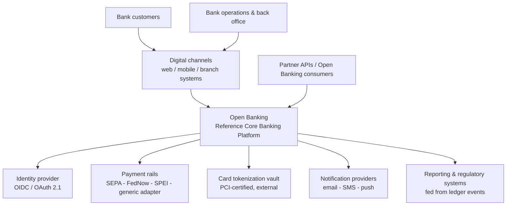
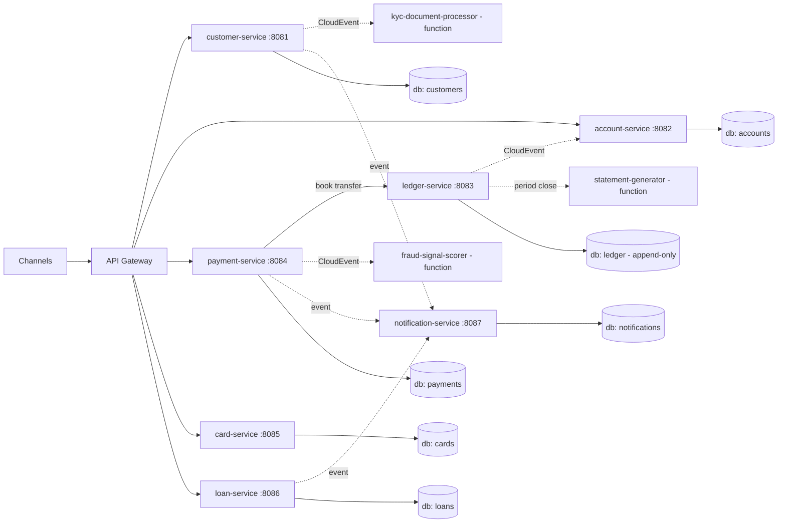
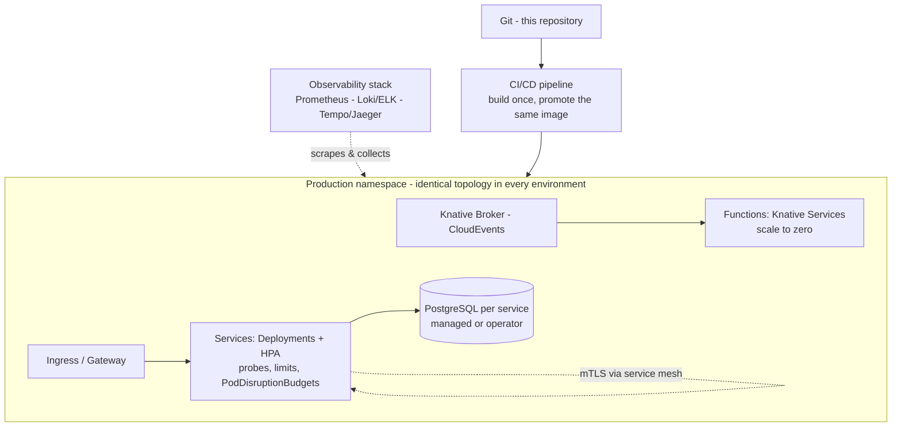
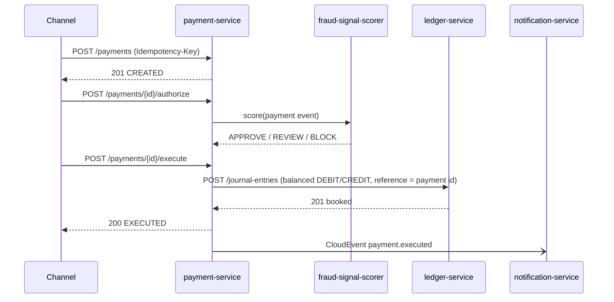
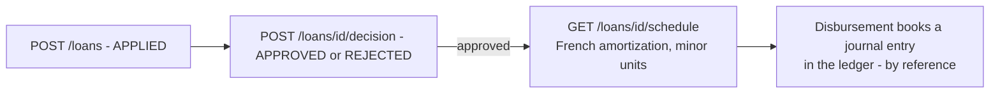

# Architecture Diagrams

All diagrams are Mermaid, rendered natively by GitHub. They are views governed by the
viewpoints defined in `architecture-description.md` (ISO/IEC/IEEE 42010).

## D-1 — System Context (C4 Level 1)

## D-2 — Containers (C4 Level 2)

## D-3 — Deployment (Kubernetes / OpenShift + Knative)

## D-4 — Payment execution sequence (internal rail)

## D-5 — Loan amortization flow

