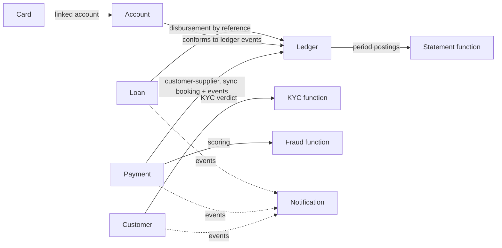

# Domain Model and Bounded Contexts

Ubiquitous language and context design. This document expands (and supersedes the earlier
skeleton of) the platform domain view — VP-4 of the Architecture Description.

## Ubiquitous language (selected terms)

| Term | Meaning |
|---|---|
| **Customer (Party)** | A person or business the bank has a relationship with; owns identity data and KYC status |
| **Account** | A deposit account (checking/savings) held by one customer in one currency |
| **Journal Entry** | An atomic, balanced set of postings — the only way money moves |
| **Posting** | One DEBIT or CREDIT line of a journal entry against one account, in minor units |
| **Ledger** | The append-only collection of all journal entries; the system of record |
| **Payment Order** | An instruction to move money, with an explicit lifecycle and a rail |
| **Rail** | A settlement network adapter: INTERNAL, SEPA, FEDNOW, SPEI, GENERIC |
| **Card** | A payment card linked to an account; represented only by masked PAN + token |
| **Loan** | A credit facility with principal, term, rate (bps) and an amortization schedule |
| **Idempotency Key** | Caller-supplied key making a create operation safe to retry |

## Bounded contexts and aggregates

### Customer
- Aggregate: `Customer` (type, full name, document id, email, KYC status, status).
- Invariants: an email must be well-formed; KYC status changes only through a recorded decision.
- Events: `customer.onboarded`, `customer.kyc-decided`.

### Account
- Aggregate: `Account` (customer, type, currency, status, balance read model).
- Invariants: a CLOSED account is terminal; balance changes **only** by applying ledger postings.
- Events: `account.opened`, `account.blocked`; consumes `ledger.posting-applied`.

### Ledger
- Aggregate: `JournalEntry` with `Posting` lines.
- Invariants (enforced in `LedgerService` and covered by tests):
  1. Per currency, sum(DEBIT) == sum(CREDIT) — unbalanced entries are rejected with `422`.
  2. Append-only: no update, no delete; corrections are compensating entries.
  3. A caller `reference` books exactly once (idempotency).
- Events: `ledger.posting-applied` (per posting).

### Payment
- Aggregate: `PaymentOrder` with lifecycle `CREATED → AUTHORIZED → EXECUTED | REJECTED | FAILED`.
- Invariants: debit ≠ credit account; amount > 0; creation requires an `Idempotency-Key`;
  state transitions only along the lifecycle (illegal transitions return `409`).
- Events: `payment.authorized`, `payment.executed`, `payment.failed`.

### Card
- Aggregate: `Card` (account, brand, masked PAN, last4, status).
- Invariants: the full PAN is **never** stored or returned; a CANCELLED card is terminal.

### Loan
- Aggregate: `Loan` (customer, principal, currency, term, annual rate in bps, status).
- Invariants: only an APPLIED loan can be decided; schedules use the French system and the
  final installment absorbs rounding so the balance closes at exactly zero.

### Notification
- Aggregate: `Notification` (channel, recipient, template, status) — a delivery trail for audit.

## Context map

Anti-corruption: each context translates external rail/provider payloads at its adapter
boundary; no context leaks another context's model, and no context reads another's database
(correspondence rule CR-4 of the Architecture Description).
