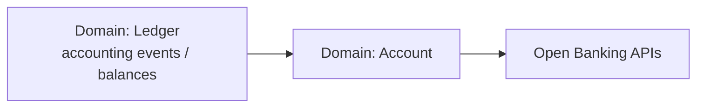

# Implementation Roadmap — Step 1 and Sequence

Decision recorded 2026-11-03 (repository owner). This roadmap governs the order in which
the generic core is implemented. It is part of the life-cycle definition
(`docs/lifecycle/software-lifecycle.md`, ISO/IEC/IEEE 15288 & 12207).

## Step 1 — scope (agreed)

Step 1 delivers exactly three things:

1. **Architecture definition + documentation** — the ISO/IEC/IEEE 42010 Architecture
   Description, the ISO/IEC 25010 quality model, the ISO/IEC/IEEE 15288 & 12207 life-cycle
   mapping, the ISO/IEC 27001 & 27002 ISMS control mapping and the Twelve-Factor mapping
   (see `docs/compliance/standards-traceability.md` for the full evidence index).
2. **One executable Quarkus skeleton: the Ledger service** — the first domain service,
   runnable and testable end to end (`services/ledger-service`).
3. Nothing else is in scope for Step 1. The remaining contexts exist in this repository as
   documented designs and reference skeletons; they are promoted to full implementations
   in later steps, in the sequence below, one PR per step.

Alignment note: everything is *aligned to* the cited standards. Nothing in this repository
is a certification or a claim of regulatory compliance, and all example data is synthetic.

## Implementation sequence (agreed)

### Step 1 — Ledger (first)

- Double-entry journal: balanced per currency or rejected; **append-only**; corrections
  are compensating entries.
- Accounting events out: `ledger.posting-applied` (CloudEvents, see `contracts/asyncapi.yaml`).
- Balances: trial balance is the authoritative read (`GET /api/v1/ledger/balances`).
- Exit criteria: `mvn verify` green for `services/ledger-service`; contract published in
  `contracts/openapi.yaml`; quality scenarios QS-02, QS-08, QS-10 demonstrated by tests.

### Step 2 — Account

- Consumes `ledger.posting-applied` events to maintain account balances as a **read model**;
  the ledger remains the system of record.
- Account lifecycle (open, block, close) with its own events: `account.opened`, `account.blocked`.
- Exit criteria: reconciliation job report matches trial balance to read model;
  QS-01 and QS-08 demonstrated by tests.

### Step 3 — Open Banking APIs

- Expose Ledger and Account capabilities through the governed Open Banking API surface:
  OpenAPI contracts, consent context, and the standard event envelope
  (`correlation_id`, `causation_id`, `schema_version`, `tenant_id`, `purpose`, data
  classification) applied end to end.
- Exit criteria: contract diff clean in CI; consent and audit trails demonstrated;
  QS-06 (portability) re-validated on the target platform.

## Later steps (order indicative, confirmed per step)

Customer/Party, Payment orchestration (sagas over Ledger + Account), Card, Loan,
Notification, and the serverless functions (KYC document processing, fraud scoring,
statement generation) — each as its own branch and pull request. **No pull request is
merged without the repository owner's explicit approval.**
