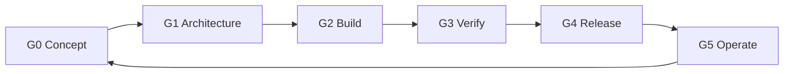

# Software Life-Cycle Processes — ISO/IEC/IEEE 15288 & 12207

This document maps the platform's way of working to the system life-cycle processes of
**ISO/IEC/IEEE 15288** and the software-specific processes of **ISO/IEC/IEEE 12207**, so an
adopting institution can slot the platform into its own governance without inventing process.

## 1. Life-cycle model

Iterative, continuous delivery on a trunk-based flow, with **stage gates** that produce the
evidence auditors and the ISMS require. The same model governs platform changes and adopter
customizations.

| Gate | Entry evidence (exit criteria) |
|---|---|
| G0 Concept | Business need, affected bounded contexts identified |
| G1 Architecture | ADR added/updated; viewpoints impacted reviewed (42010); threat model delta reviewed |
| G2 Build | Contract-first implementation; unit + contract tests green; Twelve-Factor checklist passed |
| G3 Verify | `mvn verify` green in CI; quality scenarios QS-* re-run for touched contexts; security scans clean |
| G4 Release | Immutable image promoted; release notes; rollback plan (previous image + config) |
| G5 Operate | SLOs monitored; incidents and changes recorded; lessons feed G0 (continual improvement, 27001 §10) |

## 2. Process mapping (15288 / 12207)

| Process (15288 clause) | How it runs here |
|---|---|
| 6.1.1 Business/mission analysis | Product backlog per bounded context; G0 gate |
| 6.1.2 Stakeholder needs & requirements | Stakeholders/concerns table in the Architecture Description; quality scenarios (ISO 25010) as measurable requirements |
| 6.2.x Supply / acquisition | The repo *is* the supply: versioned releases with notes; adopters acquire by deploying a tagged release |
| 6.3.1 Project planning | Backlog + ADRs; small batches per context |
| 6.3.4 Risk management | Threat model, architecture trade-offs (AD §8), ISMS risk register at adopter level |
| 6.3.5 Configuration management | Git is the single CM system: code, contracts, docs, manifests; semantic release tags |
| 6.3.7 Measurement | Metrics, SLOs and CI evidence (`docs/operations/slos.md`) |
| 6.4.1 System analysis / requirements definition | Contract-first API design (`docs/api/api-standards.md`); domain model as requirements language |
| 6.4.3 Architecture definition | The 42010 Architecture Description + ADRs |
| 6.4.4 Design definition | Hexagonal component view; per-service READMEs |
| 6.4.5 Implementation (12207) | Java/Quarkus modules; identical layout per service |
| 6.4.6 Integration | Contract tests between contexts; event compatibility checked in CI |
| 6.4.7 Verification | Unit, contract and scenario tests (`mvn verify`); CI gates |
| 6.4.8 Transition | Image promotion across environments; runbook deployment procedure |
| 6.4.9 Validation | Quality scenarios QS-01…QS-10 executed against a reference environment per release |
| 6.4.10 Operation | Runbook, SLO alerts, on-call evidence |
| 6.4.11 Maintenance | Backlog-driven; ADRs supersede — never silently edit — decisions |
| 6.4.12 Disposal | Data retention/erasure rules in the data architecture; service retirement = remove module + manifests via ADR |

## 3. Roles (RACI summary)

| Activity | Responsible | Accountable | Consulted | Informed |
|---|---|---|---|---|
| Architecture decision (ADR) | Architect | Chief architect | Security, SRE | All teams |
| Contract change | Owning service team | API governance | Consumers | Platform team |
| Release promotion | SRE | Release manager | Owning team | Operations |
| Security exception | CISO office | CISO | Architect | Auditors |

## 4. Records kept per release

Release notes, CI run link, test/scan reports, image digests promoted, ADRs merged, SLO
snapshot. These records are the objective evidence for ISO 12207 information items and for
ISO 27001 clause 9 performance evaluation.
