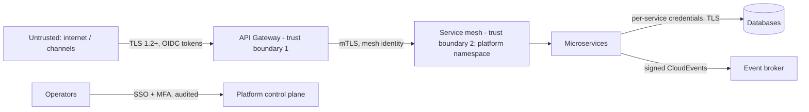

# Security Architecture

Security viewpoint (VP-7) of the Architecture Description. The management system around this
architecture is ISO/IEC 27001; the controls implemented are mapped to ISO/IEC 27002 in
`iso-27001-27002-control-mapping.md`. A STRIDE threat model is in `threat-model.md`.

## 1. Trust boundaries

## 2. Identity and access

- **Customers/channels**: OAuth 2.1 authorization code + PKCE against the institution's IdP;
  the gateway validates JWT access tokens (`OIDC_ISSUER` is configuration) and propagates a
  correlation id and the subject — services never accept unauthenticated external traffic.
- **Service-to-service**: workload identity with mTLS (service mesh); authorization is
  deny-by-default network policy per namespace (see `deploy/`).
- **Humans**: SSO + MFA for platform and repository access; least privilege and quarterly
  access review (ISO 27002 A.5.15).
- **Segregation of duties**: ledger database grants are **insert-only** for the ledger
  service identity; no human identity holds write grants on production banking data.

## 3. Data protection

- **In transit**: TLS 1.2+ everywhere; mTLS inside the platform.
- **At rest**: platform-managed encryption for databases and volumes; field-level encryption
  is available at the adapter for the most sensitive attributes (customer document id).
- **Minimization**: the card context stores only masked PAN + token (PCI DSS scope
  reduction); personal data is never written to logs; notification recipients are redacted
  in log output.
- **Secrets**: only in the platform secret store, injected as environment variables at
  runtime (12-Factor III). The repository contains no secrets; CI runs secret scanning.

## 4. Application security rules (binding for every service)

1. Validate all input at the boundary (Jakarta Validation on every request DTO).
2. Errors are RFC 9457 problem details — no stack traces, no internal identifiers.
3. Every state-changing operation is idempotent and audit-logged with actor, timestamp,
   correlation id and business reference (ISO 27002 A.8.15).
4. Dependencies are BOM-managed and scanned in CI; images are rebuilt on base-image CVEs.
5. No custom cryptography; tokenization, KMS and IdP are platform/provider responsibilities.

## 5. Audit and evidence

Structured logs to stdout (12-Factor XI) flow to the institution's SIEM. The ledger itself
is an immutable audit record of money movement. Architecture evidence for auditors: this
document set, the ADRs, the control mapping and the life-cycle records.
